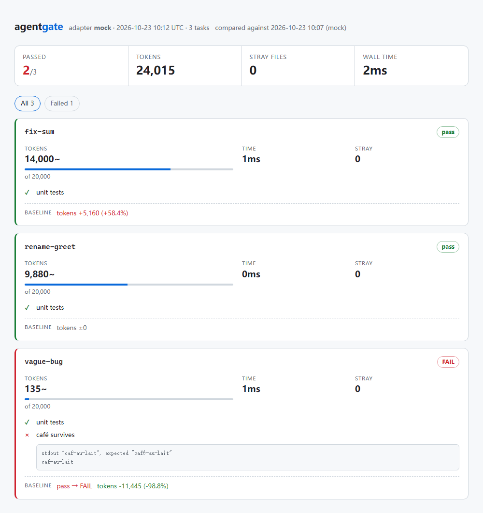
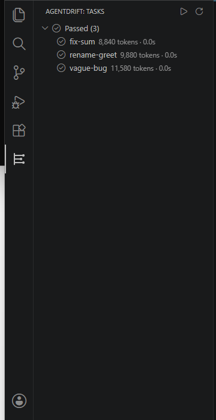

# agentdrift

**Regression tests for coding agents.**

[](https://github.com/Sebitment/agentdrift/actions/workflows/ci.yml)
[](LICENSE)
[](package.json)

You test your code. You don't test what the agent does to it.

agentdrift runs an agent against a **fixture repo** and decides on evidence: did the checks pass,
what did it spend, what did it touch. A run that passes but burns 10× the tokens, or edits
`package.json` to get there, goes red — before it reaches `main`.



## 30 seconds, no API key, no network

```bash
git clone https://github.com/Sebitment/agentdrift && cd agentdrift
npm run demo          # three fixture tasks against a mock agent
start report.html     # macOS/Linux: open report.html
```

Against the agent you actually use — same tasks, same report:

```bash
node src/cli.ts run --adapter claude --only fix-sum
```

To gate your own repo, point `--tasks` at a directory of fixtures (see [Task format](#task-format)):

```bash
node src/cli.ts run --adapter claude --tasks tasks --save-baseline    # first run
node src/cli.ts run --adapter claude --tasks tasks --baseline --fail-on-regression
```

## What it catches

| What you notice | What agentdrift measures | Where the number comes from |
|---|---|---|
| "It said it was done" | `checks` — plain shell commands | exit code + stdout, never an LLM verdict |
| "It got more expensive" | tokens per task vs budget or baseline | the CLI's own usage report; `~` marks estimates |
| "It touched things it shouldn't" | files changed outside `allow` | `git status` after the run |
| "It broke something else" | baseline diff: `pass → FAIL`, new strays | the saved `last-run.json` / `baseline.json` |

```
TASK          RESULT  TOKENS   COST  TIME  STRAY
────────────  ──────  ───────  ────  ────  ─────
fix-sum       pass    8,840~   -     1ms   0
rename-greet  pass    9,880~   -     2ms   0
vague-bug     pass    11,580~  -     1ms   0

3/3 passed  ·  30,300 tokens  ·  0 stray files  ·  4ms
```

<details>
<summary><b>Two failures it is built to catch</b></summary>

Green checks, broken output — the unit test only compared exit codes until `expectStdout` was added:

```
TASK              RESULT  TOKENS   COST  TIME  STRAY
────────────────  ──────  ───────  ────  ────  ─────
green-but-broken  FAIL    135~     -     1ms   0

0/1 passed  ·  135 tokens  ·  0 stray files  ·  1ms

green-but-broken
  check failed: café survives
    stdout "caf-au-lait", expected "café-au-lait"
```

```
TASK         RESULT  TOKENS   COST  TIME  STRAY
───────────  ──────  ───────  ────  ────  ──────────────
scope-creep  FAIL    13,920~  -     2ms   1 package.json

0/1 passed  ·  13,920 tokens  ·  1 stray files  ·  2ms

scope-creep
  files outside allow: package.json
```

</details>

## Why another agent tool

Most agent benchmarks answer *"can the model solve this task?"*. They don't answer the two things
that actually hurt in daily use:

1. **It cost how much?** A run that passes but burns 300k tokens is a regression.
2. **It changed what?** A one-line fix that rewrites `package.json` and three unrelated files is a
   bug in the agent, and nobody notices because the tests still pass.

agentdrift is a **gate**, not a leaderboard: it runs your own fixtures in CI, against the agent you
actually use.

## How it works

```
tasks/<id>/
  task.mjs   what to ask + how to verify
  mock.json  canned agent behaviour (offline adapter)
  repo/      the fixture repo the agent gets to edit
```

For every task:

1. copy `repo/` into `.agentdrift/work/<id>/` and `git init` + commit a baseline
2. hand `prompt` to the adapter
3. `git status` → files touched; anything outside `allow` is a **stray**
4. run `checks` (plain shell commands) → pass/fail
5. compare token usage against `budget`

A task passes only when the checks pass, nothing strayed, and the budget held.

> The full pipeline, the pass rule, the module boundaries and the "how do I add a task / adapter /
> metric" recipes live in [docs/WORKFLOW.md](docs/WORKFLOW.md).

## Tracking drift

A gate is only useful if it says *when* things got worse. Save a run, compare the next one against it:

```bash
node src/cli.ts run --adapter mock --save-baseline                  # record today
node src/cli.ts run --adapter claude --baseline                     # compare tomorrow
node src/cli.ts run --adapter claude --baseline --fail-on-regression  # ...and fail CI on drift
```

```
vs baseline 2026-10-23 10:05:55 (mock)
  fix-sum       pass  tokens +5,160 (+58.4%)
  rename-greet  pass  tokens 0
  vague-bug     pass -> FAIL  tokens -11,445 (-98.8%)
```

A **regression** is any of: a task that used to pass now fails, a new file outside `allow`, or token
usage up more than 20%. The baseline lives in `.agentdrift/baseline.json` (gitignored); point
`--baseline-file` at a repo path when you want to commit it.

## Visual report

Add `--html` and you get one self-contained file: inline CSS, no assets, no CDN, no server. It opens
offline and drops straight into CI artifacts or a PR comment.

```bash
node src/cli.ts run --adapter mock --baseline --html report.html
```


Per-task cards show the pass rule in one glance — token bar against the task's budget, failing check
output, stray files as chips, and the baseline delta on the same card. Filter to failures with one
click. Dark and light themes follow the OS setting.

The file is a pure function of the results (`renderHtml` in `src/html.ts`), so you can rebuild it
from any `--json` output without re-running the agent.

## VS Code panel

The CLI stays the source of truth; the panel is a thin view over `.agentdrift/last-run.json`, which
every `agentdrift run` writes.



```bash
# install the packaged extension (works in any VS Code 1.85+)
code --install-extension releases/agentdrift-vscode-0.2.0.vsix
# ...or from source
cd vscode-extension && npm install && npm run build   # then F5 with this folder open
```

It works in **any** folder, not just this repo. The panel resolves the CLI in this order: the
`agentdrift.cliCommand` setting → `node_modules/.bin/agentdrift` → this checkout's `src/cli.ts` →
`PATH` → `npx agentdrift`.

| setting | default | what it does |
| --- | --- | --- |
| `agentdrift.adapter` | `mock` | `mock` replays fixtures offline; `claude` runs the real CLI |
| `agentdrift.tasks` | `tasks` | task directory, relative to the workspace root |
| `agentdrift.baseline` | `false` | adds `--baseline` to every run |
| `agentdrift.cliCommand` | `""` | explicit command, e.g. `node "C:/tools/agentdrift/src/cli.ts"` |

- failed tasks first, each with the reason it went red (stray / over budget / failed check)
- status bar shows `n/m` and turns orange when anything fails
- ▶ runs the selected adapter, ⚙ runs one task, 📌 records a baseline
- a task click opens the HTML report in a webview; output streams to the `agentdrift` Output panel

Because it only reads the last run, a CI run, a terminal run and the panel can never disagree.
Being a pure reader also makes it safe in untrusted workspaces — it declares
`untrustedWorkspaces.supported`, so it is not disabled by Restricted Mode.


## Quickstart

Requires **Node >= 22.18**. Running from a clone executes the TypeScript sources directly (Node strips
types, no build step); the published package ships prebuilt JavaScript in `dist/`.

```bash
git clone <this repo> agentdrift
cd agentdrift

# no API key needed: the mock adapter replays canned edits
node src/cli.ts run --adapter mock

# see a run go red (the agent "helpfully" edits package.json)
node src/cli.ts run --adapter mock --tasks examples
```

With Claude Code installed and authenticated:

```bash
node src/cli.ts run --adapter claude --tasks tasks
```

### Use it in your own project

```bash
npm i -D github:Sebitment/agentdrift#v0.2.0   # pinned tag, ships compiled dist/, no registry needed
npx agentdrift list                          # walkthrough in docs/WORKFLOW.md
```

Once the package is on npm, the same thing is `npm i -D agentdrift`. Either way the CLI has zero
runtime dependencies.

Point `--tasks` at a directory inside your repo; the agent gets a copy of `tasks/hello/repo/`, never
your working tree.

## Task format

`tasks/fix-sum/task.mjs`:

```js
export default {
  id: 'fix-sum',
  prompt: 'The sum() function in src/app.js returns the wrong value. Fix it.',
  allow: ['src/**'],                              // glob whitelist; default: everything
  checks: [
    { name: 'unit tests', run: 'node --test' },
    // an exit code alone is not always enough — assert the behaviour itself
    { name: 'café survives', run: `node -e "..."`, expectStdout: 'café-au-lait' },
  ],
  budget: { maxTokens: 80000, maxMinutes: 2 },
}
```

`tasks/fix-sum/mock.json` — only used by `--adapter mock`:

```json
{
  "edits": [{ "file": "src/app.js", "content": "export function sum(a, b) {\n  return a + b\n}\n" }],
  "usage": { "inputTokens": 8200, "outputTokens": 640 }
}
```

## Adapters

| adapter  | status      | notes                                                        |
| -------- | ----------- | ------------------------------------------------------------ |
| `mock`   | stable      | offline, deterministic, drives CI and the demo                |
| `claude` | experimental| shells out to the `claude` CLI and parses `stream-json` usage |

The `claude` adapter is verified end-to-end, not just wired up: Claude Code **2.1.308**, `fix-sum`,
2026-10-23 — checks green, 0 stray files, 50,023 tokens, $0.08, 4.7s.

```bash
node src/cli.ts run --adapter claude --only fix-sum    # needs the claude CLI, costs real tokens
```

Adding one is a single file: implement `{ id, detect, run({ cwd, prompt, timeoutMs }) }` in
`src/adapters/`. PRs for `gemini` and `codex` are welcome.

## Development

```bash
npm install      # only needed for typecheck; running the CLI needs no dependencies
npm test         # unit tests (node:test)
npm run typecheck
```

## Publishing

The npm package is **not on the registry yet** — on purpose. Distribution today is the git tag and
the GitHub release, which is everything a stranger needs. When there is a version worth announcing:

```bash
npm test && npm run typecheck                 # CLI unit tests + types
npm publish --registry=https://registry.npmjs.org/
```

Two gotchas that bit us: this machine's default registry is a mirror
(`registry.npmmirror.com`), so `--registry` is not optional, and npm refuses to publish without 2FA
unless you use a granular access token with **Bypass 2FA** enabled.

For the panel: `cd vscode-extension && npm test && npm run package`, then attach the `.vsix` to the
release. `vsce publish` with a personal access token does the Marketplace in one command.

Release history lives in [CHANGELOG.md](CHANGELOG.md); the release body comes from
[docs/release-notes-0.2.0.md](docs/release-notes-0.2.0.md).

## Design rules

- **No LLM judging.** A task passes when its `checks` pass. Anything else is not reproducible.
- **Honest numbers.** Token counts come from the CLI when it reports them; estimated values are
  marked with `~` in the output, never silently mixed with measured ones.
- **Blast radius comes from `git`**, not from asking the model what it changed.

## Roadmap

- `v0.2` ✅ baseline comparison (`--baseline`), self-contained HTML report (`--html`)
- `v0.4` ✅ VS Code panel: `n/m` in the status bar, per-task reasons, report webview
- `v0.5` `gemini` / `codex` adapters, marketplace release, cost per task

## 中文

**你测代码，但你没测 agent 对你的代码做了什么。**

agentdrift 把一次 agent 运行当成构建产物来验证：给它一个任务和一个 fixture 仓库，跑完对比
「花了多少 token」和「改了哪些文件」。超出预算、动了白名单之外的文件、或者测试挂了，就直接变红。

不需要 API key，`node src/cli.ts run --adapter mock` 就能看到完整流程（内置离线适配器）。
接入真实 agent 目前支持 Claude Code CLI。

支持基线对比：`--save-baseline` 记录一次结果，`--baseline` 下次跑时逐任务对比，
`--fail-on-regression` 让 CI 在「曾经通过的任务挂了 / token 暴涨 20% / 多改了文件」时失败。

也支持可视化：加 `--html report.html` 生成一个不依赖网络和服务的单文件报告，任务卡里能直接看到
token 条、失败原因、越界文件和基线变化。

## License

MIT
