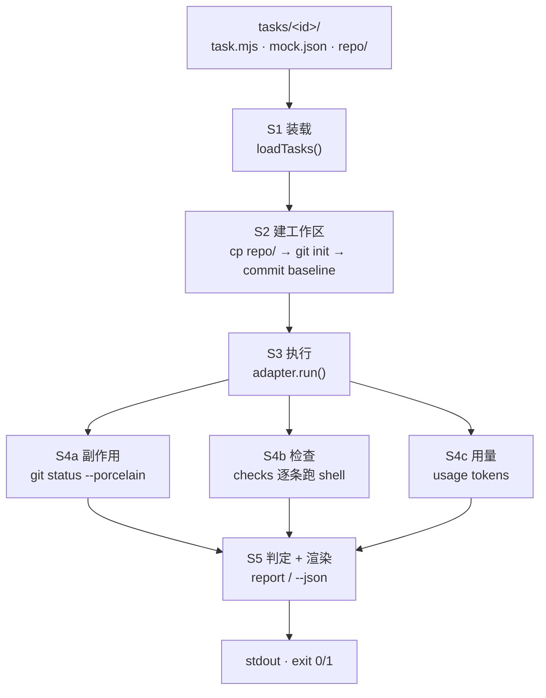

# 工作流与框架

> 这份文档定义两件事：**一次运行怎么流转**（流程），以及**代码为什么这样分层、新东西该往哪加**（框架）。
> 规则：改行为之前先改这里，代码和文档不一致时以文档为准，把代码改回来。

## 0. 一句话与三条不变量

agentgate 把一次 agent 运行当作构建产物来验收：给它一个任务和一份 fixture 仓库，跑完对比「花了多少」和「动了什么」，不合格就红。

| 不变量 | 含义 | 具体保证 |
| --- | --- | --- |
| I1 确定性 | 同一任务 + 同一适配器，判定必须可复现 | 不做 LLM 判分；判定只看退出码、`git status`、token 数 |
| I2 隔离 | 每次运行都从 fixture 重新开始 | `rm -rf` 工作区 → 拷贝 `repo/` → `git init` → commit baseline |
| I3 诚实 | 实测和估算绝不混在一起 | CLI 报了 usage 就用实测；否则标 `~`，报告里一眼可见 |

## 1. 运行时流程

### 1.1 五个阶段



| 阶段 | 代码位置 | 输入 | 输出 | 中断条件 |
| --- | --- | --- | --- | --- |
| S1 装载 | `src/task.ts#loadTasks` | `--tasks` 目录 | 按 id 排序的 `LoadedTask[]` | 目录不存在；模块没有导出 `{id, prompt}` |
| S1' 过滤 | `src/cli.ts` | `--only` | 子集 | 过滤后为空 → exit 2 |
| S2 建工作区 | `src/runner.ts#runTask` | `LoadedTask` | `.agentgate/work/<id>/` 已初始化 | git 不可用 |
| S3 执行 | `src/adapters/*#run` | `RunContext` | `RunResult` | 超时（`maxMinutes`，默认 5）→ 记 error，不中断批次 |
| S4 度量 | `src/runner.ts` | 工作区 | 改动文件 / 检查结果 / usage | 单条 check 超时（默认 120s）→ 记 exit 124 |
| S5 判定 | `src/runner.ts` | 上面三路 | `TaskResult.pass` | — |
| S5' 渲染 | `src/report.ts` | `TaskResult[]` | 表格或 JSON | — |

**S3 的设计约束**：适配器只负责“驱动外部 agent 并报告用了多少”，它不得修改 fixture、不得调用 git、不得做任何判定。所有判定都在 S4/S5，因为它们要能被单独测试。

### 1.2 判定规则（唯一的真相）

```text
pass = !error
    && checks.every(c => c.ok)
    && filesOutsideAllow.length === 0
    && budgetExceeded.length === 0
```

| 条件 | 来源 | 违约时的输出 |
| --- | --- | --- |
| `error` | 适配器抛异常 / 超时被杀 | `error: …` |
| `checks[].ok` | `run` 的退出码 === `expectExit`（默认 0） | `check failed: <name>` |
| `filesOutsideAllow` | `git status --porcelain` 的路径不在 `allow` 里（默认 `**`） | `files outside allow: …` |
| `budgetExceeded` | `in+out > maxTokens` 或 `duration > maxMinutes` | `budget: …` |

> 最容易误解的一点：**测试绿了 ≠ pass**。一个让测试全绿但顺手改了 `package.json` 的 agent，这里必须红。

### 1.3 退出码契约

| 退出码 | 含义 | 产生位置 |
| --- | --- | --- |
| 0 | 全部 pass | `src/cli.ts` |
| 1 | 至少一个任务 FAIL（`--exit-zero` 可压回 0） | `src/cli.ts` |
| 2 | 用法/环境错误：无任务、未知适配器、适配器不可用 | `src/cli.ts` |
| 1 | 未捕获异常（带 stack） | `main().catch` |

CI 里用 `--json` 拿结果，用退出码做门禁；两者不要再造第三套。

### 1.4 目录约定

```text
tasks/<id>/         正式任务，提交进仓库，必须全绿
  task.mjs          { id, prompt, allow?, checks?, budget? }
  mock.json         离线适配器的剧本（不参与真实运行）
  repo/             夹具仓库，agent 从这里开始改
examples/<id>/      故意失败的任务，CI 用来验证“失败路径还能正确报错”
.agentgate/work/    运行时产物，已 gitignore，可随时删
```

## 2. 代码框架

### 2.1 分层与依赖方向

依赖只能向下，不允许反向或横穿：

```text
cli ──▶ runner ──▶ adapters
 │         ├──▶ git
 │         └──▶ glob
 ├──▶ report ──▶ types
 └──▶ task   ──▶ types
```

`types.ts` 在最底层，**只有类型没有运行时代码**——所以任何模块都可以安全 import 它。

### 2.2 模块职责与红线

| 文件 | 职责 | 不允许做的事 |
| --- | --- | --- |
| `src/types.ts` | 所有数据契约 | 写运行时代码 |
| `src/glob.ts` | `*` `**` `?` 匹配 | 读文件系统 |
| `src/git.ts` | git 封装（init / status） | 做业务判断 |
| `src/task.ts` | 从磁盘装载任务定义 | 执行任务 |
| `src/adapters/*` | 驱动外部 agent，返回 `RunResult` | 改 fixture、跑 check、做判定 |
| `src/runner.ts` | 编排一次运行并判定 | 打印、格式化 |
| `src/report.ts` | 渲染表格 / JSON | 读磁盘、做判定 |
| `src/cli.ts` | 参数解析与流程调度 | 藏业务规则 |

### 2.3 数据契约

```ts
// 任务（用户写的，存在 task.mjs 里）
Task = { id, prompt, allow?: string[], checks?: Check[], budget?: Budget }
Check = { name?, run: string, expectExit?: number, timeoutMs?: number }
Budget = { maxTokens?: number, maxMinutes?: number }

// 适配器边界
RunContext = { cwd, taskDir, prompt, timeoutMs }
RunResult  = { exitCode, usage, transcript, durationMs, error? }
Usage      = { inputTokens, outputTokens, usd?, estimated? }

// 运行结果（--json 的输出，也是未来 VS Code 面板的接口）
TaskResult = {
  id, pass,
  checks: { name, ok, detail? }[],
  usage, durationMs,
  filesTouched, filesOutsideAllow, budgetExceeded,
  error?
}
```

`--json` 打印的是 `TaskResult[]`，进度信息走 stderr。**字段名不要随手改**：CI 脚本和面板都依赖它。

### 2.4 三种扩展剧本

**A. 加一个任务（10 分钟）**

1. `tasks/<id>/repo/` 放一份**当前状态下测试是失败的**最小仓库
2. `tasks/<id>/task.mjs`：写 `prompt`、`allow`、`checks`、`budget`
3. `tasks/<id>/mock.json`：写“正确解法”会产生的编辑
4. 验收：`node src/cli.ts run --adapter mock --only <id>` 必须 pass
5. 反验收：把 mock.json 里的编辑删掉，必须 FAIL（证明这个任务真的能区分对错）

**B. 加一个适配器（半天）**

1. 复制 `src/adapters/mock.ts` 的骨架，实现 `detect()` 与 `run()`
2. 在 `src/cli.ts#makeAdapter` 注册，并加进 `--help`
3. README 的适配器表加一行，注明是否 experiment
4. 用真实 CLI 跑一次 `--only <一个简单任务>`，把 usage 字段对不对记进 PR 描述
5. 不要为了适配器去改 runner：**改不动 runner 才是合格的适配器**

**C. 加一个指标（1 小时）**

三处按顺序改，顺序错了会漏：

1. `src/types.ts`：`TaskResult` 加字段
2. `src/runner.ts`：在 S4 计算，在 S5 参与 `pass`
3. `src/report.ts`：加列 + 加 summary
4. 在 `examples/` 加一个能让这个指标变红的任务，证明它真的生效

## 3. 开发工作流

### 3.1 单个改动的五步环

```text
1. 行为要变？先改 docs/WORKFLOW.md
2. 写测试：test/*.test.mjs，或 examples/ 里一个失败任务
3. node --test "test/*.test.mjs"
4. node src/cli.ts run --adapter mock          ← 必须全绿
   node src/cli.ts run --adapter mock --tasks examples --exit-zero  ← 必须红且报对文件
5. npx tsc --noEmit
```

第 4 步后半段不要省：失败路径才是这个项目的主体功能。

### 3.2 分支与提交

- `main` 永远绿，红了就是 P0
- 分支：`feat/…` `fix/…` `docs/…`
- 提交：`feat: …` / `fix: …` / `docs: …` / `test: …`，一次提交只做一件能回滚的事
- 涉及输出的改动，PR 里贴前后两段终端输出

### 3.3 CI 三道门（`.github/workflows/ci.yml`）

1. 单元测试全过
2. 离线 demo 全绿（证明主路径没坏）
3. 失败路径必须报出 `stray`（证明红线还在）

### 3.4 发布

- `0.x` 阶段：打 tag + release notes，不急着发 npm
- 上 npm 的条件：有第二个适配器 **且** README 里有 5 个真实任务的数据
- 版本号规则：加适配器/指标 → minor；修 bug → patch

## 4. 边界：v0.1 明确不做

| 不做 | 原因 | 什么时候做 |
| --- | --- | --- |
| LLM 判分 | 不可复现，违反 I1 | 永远不做，最多做“建议” |
| 内置任务集 | 任务属于用户自己的仓库 | v0.3 提供模板生成器 |
| 并发跑多任务 | 先保证可复现和输出可读 | v0.2 |
| baseline 对比 | 需要历史数据格式 | v0.2 |
| VS Code 面板 | 只是 `--json` 的渲染器 | v0.4 |

## 5. 两周里程碑

| 时间 | 交付 | 验收 |
| --- | --- | --- |
| W1（已完成） | CLI + mock/claude 适配器 + 2 个示例任务 + CI | `node src/cli.ts run --adapter mock` 全绿 |
| W2 | `--baseline` 对比、`--json` 稳定、5 个真实任务、README 数据 | PR 里有真实 agent 的前后对比 |
| W3 | `gemini` 适配器、任务模板生成器 | 两个适配器跑同一批任务 |
| W4+ | VS Code 面板 | 面板只读 `--json`，不改判定逻辑 |
